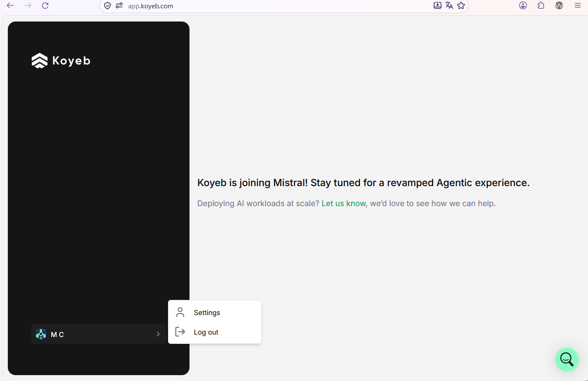
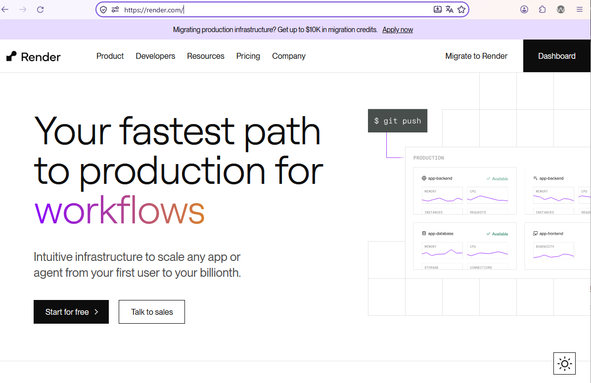

# Crear una cuenta en Koyeb.com

:warning: Utilizamos esta plataforma cuando recibimos capacitación de Docker; pero durante las clases del ciclo: 02/2026 con estudiante no se pudo utilizar porque aparenente la plataforma está presentando problemas.

  

:star: Para el despliegue de la aplicación en 2026 utilizamos otra plataforma similar. La plataforma utilizada fue ```https://render.com/```

  

## Paso 1. Ingrese a koyeb.com

[https://www.koyeb.com/](https://www.koyeb.com/)  


## Paso 2. Llene el formulario


## Comentario
🤵**Identificación** La cuenta será habilitada por 7 días según las indicaciones dadas por la plataforma. Le peditará configurar su información personal mediante la captura de imágenes de un documento como el DUI y además, fotografía de su rostro. Para ver el contenido del sitio web publicado no necesariamente deberá enviar su información; personal pero es probable que después de 7 días sea obligatorio para disponer de la cuenta.  

## Eliminación de organización Plan Pro y creación de organización Plan Hobby


Escriba el nombre de la organización y luego haga clic en **Deactivate**  


Le enviarán una notificación al correo electrónico para desativar la cuenta (esta imagen la capturé de otra cuenta).  


Luego de desactivar la cuenta **Plan Pro**, haga una nueva organización con **Plan Hobby**.  Esta nueva organización no tendrá vencimiento.  


  


Continúe con el asistente.

  

Su nueva cuenta debe quedar con Hobby Plan  


